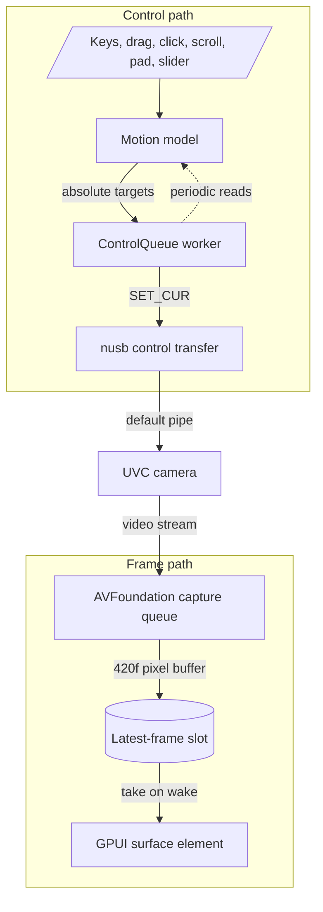

# camctl

[](https://github.com/jamesainslie/camctl/actions/workflows/checks.yml)

> **OBSBOT Center is bloatware, and it shows you adverts.** Zooming and
> aiming a webcam takes a handful of standard USB requests. OBSBOT's app
> for the job is 713 MB, runs two processes and 80 threads, and keeps the
> camera streaming after you hide its window. On top of that, it scrolls
> promotions across its own title bar, and there is no setting to turn
> them off. The app you need to point your own camera has no business
> advertising to you. camctl does the same job in one small process, with
> no adverts and no network traffic, and it sits idle with the camera off
> while you are not using it.

## camctl vs OBSBOT Center

| | camctl 0.1.0 | OBSBOT Center 2.0.15 |
|---|---:|---:|
| Preview hidden: CPU | 0.03% | 28.5% |
| Preview hidden: memory | 85 MB | 1,297 MB |
| Preview hidden: camera | Off | Still streaming |
| Live preview: CPU | 20.7% | 56.9% |
| Live preview: memory | 305 MB | 1,177 MB |
| Live preview: threads | 23 | 80 |
| Processes | 1 | 2 |
| Size on disk | 19 MB, 3 files | 713 MB, 1,401 files |
| Network traffic | None | 129 KB received in its first 4 minutes |
| Adverts | None | In the title bar, with no way to turn them off |

Running in the background with its window hidden, which is how you keep
OBSBOT Center around for its controls, it uses over a quarter of a CPU
core and 15 times camctl's memory, and the camera stays on. While
previewing, it uses nearly three times camctl's CPU and nearly four times
its memory.

How this was measured: on 2026-10-17, on an Apple M4 Pro running macOS
26.7.1, with an OBSBOT Tiny 2 Lite. Each app ran alone at its default
settings and was sampled with `top` once a second for 60 seconds. CPU,
memory footprint and threads are summed over all of the app's processes,
and CPU is a percentage of one core. In live preview, OBSBOT Center showed
the camera's 4K stream in a 1256x703 window, and camctl showed a 640x360
stream in its 640x420 window. Picking the smallest stream that fills the
window is part of how camctl stays light. The macOS camera service
(UVCAssistant) used a further 6% of a core for camctl's preview, and 9%
for OBSBOT Center whether its window was showing or not. The machine was
busy with other work at the time, so the absolute numbers may read high
for both apps. The two were measured back to back under the same
conditions.

camctl is a small, fast macOS menu bar app and command line tool for
controlling PTZ (pan, tilt, zoom) webcams. It shows a live preview, aims the
camera smoothly with the keyboard, mouse or trackpad, and exposes every
standard control the camera has. It was built for the OBSBOT Tiny 2 Lite,
and because it speaks only the standard USB Video Class (UVC 1.1) controls
it works with any UVC camera that offers them.

## Why camctl exists

The OBSBOT Tiny 2 Lite is a good camera with a poor companion app. To zoom
or aim the camera you have to run OBSBOT Center. It is a heavy,
always-running app, built for features many people never use (AI tracking,
gestures, a virtual camera). It keeps the machine busy and the camera on
while it runs, and it advertises to you while it does
([the numbers](#camctl-vs-obsbot-center)).
The camera itself does not need any of that: zoom, pan, tilt, exposure,
focus and white balance are all ordinary UVC controls that any program can
set over USB.

camctl is the small tool for just that job. It lives in the menu bar, does
nothing while you are not using it, and gives you the camera's controls
directly.

## Aims

- **Light.** No work while the preview is hidden or you are away: no
  capture, no timers, the camera light off. While previewing, frames go
  from the camera to the GPU without being copied, and the preview prefers
  formats that need no decoding.
- **Smooth.** Pan, tilt and zoom move continuously while held and stop the
  moment you let go, from keys, a drag, a pad or the scroll wheel. A click
  aims the camera at what you clicked.
- **Complete.** Every standard UVC 1.1 camera terminal and processing unit
  control the camera advertises can be read and set, from the app's
  controls or the `camctl` CLI.
- **Standard.** Only the UVC specification, so nothing breaks when the
  vendor's app updates, and other cameras work too.
- **Honest.** When the camera is paused, stuck or missing, the window says
  so, and state changes are logged for diagnosis.

## Non-goals

- OBSBOT's AI features and other vendor-specific controls. They live in a
  vendor extension unit that camctl lists but never drives, so tracking
  and gestures stay in the vendor's app.
- A virtual camera. Other apps read the camera directly, and camctl changes
  the controls they see.
- Platforms other than macOS. Capture uses AVFoundation, the menu bar and
  window use AppKit, and USB device matching relies on IOKit.

The workspace produces two programs:

- `camctl.app` (crate `camctl-app`): a menu bar icon and a floating live
  preview with pan, tilt and zoom.
- `camctl` (crate `camctl-cli`): a CLI that lists cameras and reads and
  writes their controls.

## Features

### Menu bar icon

- The icon is a gimbal camera drawn in code as a template image, so it follows the menu bar's light or dark appearance. The lens fills while frames are streaming.
- Left click shows or hides the preview. Right click or Control-click opens a menu with **Show or Hide Preview**, **Camera** (see [Choosing the camera](#choosing-the-camera)), **Sleep Camera** (**Wake Camera** while it sleeps), **Reconnect Camera** (see [Reconnecting](#reconnecting)) and **Quit camctl**.
- **Quit camctl** stops the camera, then quits. If the camera has not stopped within about 2 s, camctl quits without it.
- The app has no Dock icon.

### One camctl at a time

Only one camctl runs at a time, whichever copy is launched: an installed app and a fresh build, say. A second launch adds no menu bar icon. It asks the running camctl to show its preview, then quits. The running camctl holds a lock on `~/Library/Application Support/camctl/instance.lock` for as long as it runs, and the system releases the lock when the process exits, crashed or not. If the lock cannot be taken at all, camctl runs anyway.

### Preview window

- The window floats above other apps' windows, appears on every Space and alongside full-screen apps. It opens at 640x420 points and resizes down to 320x220.
- Closing the window hides it. The menu bar icon brings it back; quit from the menu bar menu.
- Video is zero-copy. AVFoundation delivers IOSurface-backed 420f `CVPixelBuffer`s, and GPUI's `surface` element draws them without copying. Only the newest frame is kept, and late frames are discarded.
- The camera streams only while the window can be seen, the user is present and the camera is awake. Hiding the window, covering it, a sleeping display, the screen saver, the lock screen and [Sleep](#sleep) each stop the capture session, and the camera light goes off. The screen saver and lock screen are watched through system notifications, because macOS does not count the screen saver as covering other windows.
- A dot in the title bar turns green while frames arrive, next to the camera's name.

### Pan, tilt and zoom

Every input becomes either a held motion, which advances the camera smoothly while held, or a one-shot target.

| Input | Action |
|-------|--------|
| Arrow keys, held | Pan at up to 45 degrees per second and tilt at up to 35 degrees per second, reaching full speed over 0.25 s |
| Shift with a movement key | Move at 30 percent of full speed, for fine framing |
| `+` or `=`, and `-`, held | Zoom in or out at up to 60 zoom units per second |
| Drag on the video | Joystick: direction and speed follow the offset from where the drag began. Speed grows with the square of the distance, from a 4 px dead zone to full speed at 140 px |
| Click on the video | Aim the camera so the clicked point comes to the centre. A ring marks the point for 0.6 s |
| Scroll on the video | Zoom by 4 units per scroll line, or 0.15 units per pixel on a trackpad |
| On-video pad | Appears while the pointer is over the video. The arrow and zoom buttons move while pressed and held |
| `H`, `0`, or the pad's centre button | Home: pan and tilt to 0, zoom all the way out |

Zoom units are the camera's own (0 to 100 on the Tiny 2 Lite). When several inputs are held, a drag takes precedence over a pad button, and a pad button over the keyboard. Held input is released when the window loses focus, so a missed key-up cannot leave the camera moving.

The bar below the video holds the zoom slider, the current magnification (1.0x to 4.0x), and the pan and tilt angles in degrees. Pan is shown with positive to the right.

Drag and click aiming require a camera that reports absolute pan and tilt with a readable range. Zoom inputs and the slider require absolute zoom. The pad shows only the buttons the camera supports.

### Sleep

The **Sleep** button at the right of the bar, or **Sleep Camera** in the menu bar menu, puts the camera to sleep:

- The camera turns its lens down, facing the desk, with pan centred. Zoom is left alone.
- camctl stops its capture session, and the window says the camera is asleep.
- Keys, drags, clicks, scrolling, the pad and the zoom slider are ignored until the camera wakes.

**Wake**, or **Wake Camera** in the menu, aims the camera back where it pointed and resumes the preview if the window can be seen. Sleep lasts until you wake the camera. Hiding and showing the window does not wake it, and neither does camctl reopening the camera after it reconnects.

On a Tiny 2 Lite, the lens tilts to -80 degrees, and the camera then tips the rest of the way down by itself and enters its own sleep. That is the same sleep that OBSBOT Center offers, reached through the standard pan-tilt control only. A sleeping Tiny 2 Lite ignores pan and tilt until an app opens its video. On waking, camctl sends the aim again with the first frame.

Other apps that use the camera keep streaming from it. Sleep stops only camctl's preview, so the camera light stays on while another app streams.

The Sleep button sits in the bar, which appears only for a camera that camctl controls over USB. The menu item works for every camera. A camera without absolute pan and tilt does not move, so Sleep only stops the preview and Wake only resumes it. camctl does not remember sleep across launches. It starts awake, and if you quit while the camera sleeps, it does not aim the camera back.

### Choosing the camera

The **Camera** submenu in the menu bar menu lists every connected camera, USB and built in, with a check beside the one the preview shows. The list is read each time the menu opens, so a camera plugged in a moment ago appears. Two cameras with the same name are numbered, in the order macOS lists them.

Choosing another camera stops the current one, then opens the new one in the same window and shows the preview. The old camera stays where it points, and the new camera's aim and zoom are read from it. camctl remembers each camera's sleep while it runs, so the new camera starts awake unless it was asleep when camctl last showed it. The controls, pad and Sleep button follow what the new camera supports. Choosing the checked camera again shows the preview, and reopens the camera if camctl could not open it.

camctl remembers the choice across launches, by the camera's AVFoundation unique ID, in its user defaults (`defaults read us.ainslies.camctl camera`). A USB camera's ID includes its USB location, so the same camera plugged into another port counts as a different one. When the chosen camera is not connected at launch, camctl falls back to the first USB camera, or else the first camera of any kind, and keeps the choice. When the chosen camera is connected later, the preview switches to it. To forget the choice:

```sh
defaults delete us.ainslies.camctl camera
```

### Reconnecting

camctl follows cameras as they are connected, disconnected and re-enumerated. A Mac waking from sleep often re-enumerates its USB cameras, which leaves every handle camctl held to them dead.

- **The preview.** Once the connected cameras have stayed the same for about 1 s, camctl reopens the preview on the camera it should show: the chosen camera, else the first USB camera, else the built-in camera. It also reopens a camera that disconnected and came back, and one camctl could not open. The camera the preview shows gets about 4 s to come back before camctl falls back to another. A preview camctl reopens by itself does not bring the window forward, and while the window is hidden the camera stays off. A sleeping camera stays asleep across the reopen.
- **The controls.** Pan, tilt and zoom go over a USB control link, which can die while the video still works. When the camera stops answering control requests (three failures in a row, or one that says the device is gone), camctl drops the link and opens it again. The first try waits 0.5 s, and each wait doubles up to 5 s, for up to 8 tries. camctl also reopens the link each time the Mac wakes. Meanwhile input moves nothing, and the bar below the video says "reconnecting to the camera's controls…". If every try fails, the bar says "controls lost · choose Reconnect Camera in the menu".
- **Reconnect Camera.** The menu item closes the camera, capture and controls both, opens it afresh and shows the preview. Use it when the controls are lost or the preview is stuck.

## Installing a release

### Homebrew

The [yaklabco tap](https://github.com/yaklabco/homebrew-tap) carries a cask
for the app and a formula for the CLI. The repository is private, so
Homebrew needs a GitHub token that can read it, in
`HOMEBREW_GITHUB_API_TOKEN`, to download a release:

```sh
export HOMEBREW_GITHUB_API_TOKEN="$(gh auth token)"
brew install --cask yaklabco/tap/camctl
```

The cask installs `camctl.app` into `/Applications`, clears the download
quarantine (see below), and pulls in the `camctl-cli` formula, which puts
`camctl` on the `PATH`. `brew upgrade` needs the same token. Upgrading
and uninstalling quit the app first, and macOS asks once whether your
terminal may control camctl.

To start camctl at login, add it under System Settings, General, Login
Items. The cask leaves login items alone, because upgrades would remove
them.

### By hand

Each [release](https://github.com/jamesainslie/camctl/releases) carries:

- `camctl-X.Y.Z-macos-arm64.zip`, the app,
- `camctl-cli-X.Y.Z-macos-arm64.tar.gz`, the CLI,
- `SHA256SUMS`.

Unzip the app into `/Applications`. Release builds are ad-hoc signed unless
the repository has Developer ID secrets (see
[docs/RELEASING.md](docs/RELEASING.md)), so clear the download quarantine
once:

```sh
xattr -dr com.apple.quarantine /Applications/camctl.app
```

## Prerequisites

- macOS 14 or later.
- Rust via rustup. `rust-toolchain.toml` pins the compiler (1.98.1), and rustup installs it on first use. The minimum supported version is 1.98 (edition 2024), because CI tests the pinned compiler only.
- Xcode Command Line Tools, for the linker: `xcode-select --install`.
- For the development checks, [mise](https://mise.jdx.dev). `mise install` installs the versions of actionlint, cargo-deny, shellcheck and zizmor that `mise.toml` pins.
- For the app: an Apple Development code signing identity in the login keychain. List identities with `security find-identity -v -p codesigning`; Xcode can create one under Settings, Accounts, Manage Certificates.
- A UVC camera. Pan and tilt need absolute pan-tilt support, and zoom needs absolute zoom support.

## Building

```sh
git clone https://github.com/jamesainslie/camctl
cd camctl
```

### CLI

```sh
cargo build -j 3 --release -p camctl-cli
./target/release/camctl list
```

To install `camctl` into `~/.cargo/bin`:

```sh
cargo install --path crates/cli
```

The CLI sends USB control requests only and opens no video stream, so it runs as a plain binary.

### App bundle

```sh
scripts/bundle.sh
open dist/camctl.app
```

`scripts/bundle.sh [release|debug]` builds `camctl-app` with the given profile (default `release`), assembles `camctl.app` in `dist/`, writes its `Info.plist`, signs the bundle and verifies the signature. The bundle identifier is `us.ainslies.camctl`, and its version comes from the workspace `Cargo.toml`.

| Variable | Default | Description |
|----------|---------|-------------|
| `CAMCTL_JOBS` | `3` | `cargo build -j` parallelism |
| `CAMCTL_BUNDLE_DIR` | `dist` | Directory that receives `camctl.app` |
| `CAMCTL_SIGN_IDENTITY` | `Apple Development` | `codesign` identity |

If the keychain holds more than one Apple Development certificate, `codesign` rejects the default as ambiguous. Set `CAMCTL_SIGN_IDENTITY` to the certificate's full name or SHA-1 hash from `security find-identity`.

The app must run as a bundle because macOS grants camera access per signed app bundle, and the request must come from an app whose `Info.plist` carries `NSCameraUsageDescription`, the text shown in the permission prompt. The bundle also sets `LSUIElement`, which keeps the app out of the Dock. macOS remembers the grant by the app's code signature. A stable identity such as an Apple Development certificate keeps the grant across rebuilds; an ad hoc signature changes with every build, so macOS would ask again each time.

On first launch macOS asks for camera access. If access is denied, the preview says so and points to System Settings, Privacy & Security, Camera. To clear the decision and be asked again:

```sh
tccutil reset Camera us.ainslies.camctl
```

Set `CAMCTL_TRACE=1` to echo the event log to stderr as well:

```sh
open --env CAMCTL_TRACE=1 --stderr /tmp/camctl.log dist/camctl.app
tail -f /tmp/camctl.log
```

## CLI usage

```text
camctl [-c N] <command>
```

`-c`, `--camera` selects a camera by its index from `camctl list` (default `0`). The flag is global, so it may appear before or after the command.

| Command | Description |
|---------|-------------|
| `camctl list` | Connected UVC cameras, ordered by USB location: index, product name, `VID:PID` and IOKit location ID |
| `camctl controls` | Every control the camera advertises, with its current value and its range, step and default where the camera reports them |
| `camctl formats` | Streaming formats, frame sizes and frame rates from the USB descriptors |
| `camctl get <control>` | Read one control |
| `camctl set <control> <value>` | Write one control, then print the value read back |
| `camctl point <right> <up>` | Point the camera, in degrees right and up from centre, on every camera |
| `camctl home` | Pan and tilt to 0, and zoom all the way out |
| `camctl sleep` | Turn the lens down, with pan centred, to put the camera to sleep. Zoom is left alone. Needs absolute pan and tilt with a readable range |
| `camctl wake` | Pan and tilt to 0, zoom left alone. Unlike the app's **Wake**, it does not return to the earlier aim. A Tiny 2 Lite in its own sleep ignores this and wakes when an app opens its video |

### Examples

```sh
camctl list                          # find the camera index
camctl -c 1 controls                 # controls of the second camera
camctl formats
camctl point -20 5                   # 20 degrees left, 5 degrees up
camctl get pan-tilt                  # the camera's own values (an OBSBOT shows pan 20.0°)
camctl set pan-tilt -20,5            # the same move through set
camctl set zoom 40
camctl set brightness -5
camctl set focus-auto on
camctl set anti-flicker 60
camctl set exposure-mode manual
camctl set pan-tilt-move 1,5,-1,3    # starts a relative move
camctl set pan-tilt-move 0,0,0,0     # stops it
camctl home
camctl sleep                         # lens down; a Tiny 2 Lite enters its own sleep
```

Negative values parse as values, not flags, so `camctl point -20 5` and `camctl set brightness -5` need no `--`. `set` prints the value read back as `key = value`. Relative controls often cannot be read, in which case `set` reports that the write succeeded and the read-back was unavailable. Relative moves (`*-move`) continue until a stop is sent.

### Control keys and values

| Keys | Value syntax | Example |
|------|--------------|---------|
| `zoom`, `focus`, `exposure`, `exposure-step`, `exposure-priority`, `iris`, `iris-step`, `roll`, `scanning-mode`, `backlight`, `brightness`, `contrast`, `gain`, `hue`, `saturation`, `sharpness`, `gamma`, `white-balance`, `digital-zoom`, `digital-zoom-limit` | An integer that fits the control's wire width | `camctl set zoom 40` |
| `focus-auto`, `white-balance-auto`, `white-balance-component-auto`, `hue-auto`, `privacy` | `on` or `off` (also `true`/`false`, `1`/`0`) | `camctl set focus-auto off` |
| `anti-flicker` | `off`, `50`, `60` or `auto` | `camctl set anti-flicker 50` |
| `exposure-mode` | `manual`, `auto`, `shutter` or `aperture`, or one single-bit integer | `camctl set exposure-mode auto` |
| `pan-tilt` | `PAN,TILT` in degrees | `camctl set pan-tilt 10,-5` |
| `pan-tilt-move` | `PAN_DIR,PAN_SPEED,TILT_DIR,TILT_SPEED`, directions `-1`, `0` or `1` | `camctl set pan-tilt-move 0,0,1,3` |
| `zoom-move`, `focus-move`, `roll-move` | `DIR,SPEED`, direction `-1`, `0` or `1` | `camctl set zoom-move -1,2` |
| `white-balance-component` | `BLUE,RED`, each 0 to 65535 | `camctl set white-balance-component 2000,2400` |

`camctl controls` lists only the keys the selected camera advertises. Values are checked against the control's type and width before anything is sent.

## Architecture

| Crate | Responsibility |
|-------|----------------|
| `crates/uvc` (`camctl-uvc`) | UVC descriptor parsing, the control catalogue, wire encoding of values, and `Camera`, which drives controls through a `Transport` trait. No I/O |
| `crates/usb` (`camctl-usb`) | `Transport` over nusb (IOKit): finds devices with a UVC video control interface and sends class requests on the default control pipe, 500 ms timeout |
| `crates/capture` (`camctl-capture`) | AVFoundation devices, camera permission, the stream format policy, and a capture session that keeps only the newest frame |
| `crates/core` (`camctl-core`) | UI-independent logic: the motion model, including the sleep aim, the per-camera quirks table, `ControlQueue` and the control-link health check |
| `crates/cli` (`camctl-cli`) | The `camctl` binary |
| `crates/app` (`camctl-app`) | The GPUI app (through gpui-kit): preview window, AppKit menu bar item, screen saver and lock watcher, camera connect and Mac wake watcher, and the one-instance lock |



**Frame path.** The capture session's video output asks AVFoundation for 420f, Metal-compatible pixel buffers and discards late frames. Its delegate runs on a serial dispatch queue and replaces the contents of a one-frame slot. It wakes the UI thread only when it fills an empty slot, so at most one wake-up is outstanding however fast frames arrive. The UI thread takes the frame and passes its pixel buffer to GPUI's `surface` element, drawn with object-fit cover. Buffers in any other pixel format are dropped, because GPUI's surface renderer accepts only 420f.

**Control path.** While input is held, the app ticks the motion model every 33 ms. Each tick ramps the velocity toward the held speed and advances absolute pan, tilt and zoom targets. Releasing stops the targets at once, and the motor's own lag brings the camera to rest. Clicks, scroll steps, the slider, Home, Sleep and Wake produce single targets. Targets go to `ControlQueue`, which keeps only the newest value per control. A worker thread sends whatever is pending, in the order of each control's latest request, so a burst of requests collapses to the write in flight plus the final value, and dependent writes keep their order: auto focus off, then a manual focus. Reads queue the same way and run after the pending writes. Every result goes to a health check. Three failures in a row, or one that says the device is gone, mark the link dead, and the app drops the queue and opens the camera's USB device again with backoff. A stall is an answer, so it does not count. Control transfers use the default pipe and need no exclusive access, so they work while the system driver owns the camera and other apps stream from it.

**Pairing.** The app previews the camera chosen in the **Camera** menu if it is connected, otherwise the first USB camera AVFoundation lists, or the first camera of any kind. Switching cameras stops the old capture session off the UI thread, then replaces the window's preview view with a new one, so no per-camera state carries over except sleep. The app watches AVFoundation's camera connect and disconnect notifications and the Mac's wake notification. Once the cameras have settled, it makes the same choice again and replaces the preview the same way when the answer differs, when the shown camera re-enumerated, or when it could not be opened. For a UVC camera, AVFoundation's unique ID encodes the IOKit location ID, vendor ID and product ID, and the app opens the nusb device that matches all three. Enumeration and the first reads run off the UI thread, and each first read is tried up to 4 times, 150 ms apart, because a camera that is starting its stream can stall or time out briefly. A camera that does not answer the pan, tilt or zoom reads at all fails the open, which is then tried again, rather than opening without those controls.

## Development

The workspace pins its compiler in `rust-toolchain.toml` and its lint
tools in `mise.toml`. `mise install` installs the lint tools. `cargo xtask`
runs the same tasks locally and in CI:

| Task | What it does |
|------|--------------|
| `cargo xtask ci` | `lint`, then `check`: every check CI runs |
| `cargo xtask lint` | The checks that need no build: formatting, workspace rules, pinned tools, workflows, shell scripts and dependencies |
| `cargo xtask check` | The checks that build, on macOS only: Clippy and rustdoc with warnings denied, the tests, and smoke tests of the CLI and the app bundle |
| `cargo xtask install-hooks` | Point git at `.githooks`: a format check before each commit and `cargo xtask ci` before each push |
| `cargo xtask changelog-check` | Fails unless `CHANGELOG.md` changed against `origin/main` (CI runs it on PRs) |
| `cargo xtask release` | Changelog-driven release preparation: derive the version, cut the changelog, set the version, commit |
| `cargo xtask tag` | Tag `main` after a release PR merges |
| `cargo xtask verify-tag TAG` | Fails unless the tag matches `Cargo.toml` and the changelog (the release workflow runs it) |
| `cargo xtask dist` | Build the release zip, CLI tarball and checksums into `dist/` |
| `cargo xtask homebrew --tap DIR [--sums FILE]` | Write the Homebrew cask and formula for the current version into a clone of yaklabco/homebrew-tap, from `dist/SHA256SUMS` by default |
| `cargo xtask notes [VERSION]` | Print a version's release notes from the changelog |
| `cargo xtask version` | Print the workspace version |

Locally, cargo runs with 3 jobs (override with `CAMCTL_JOBS`); on CI it
uses every core.

```sh
mise install
cargo xtask ci
cargo run -p camctl-capture --example devices
```

The tests need no camera:

- The `uvc` tests parse configuration descriptors captured from an OBSBOT
  Tiny 2 Lite (`crates/uvc/tests/fixtures`) and drive `Camera` through fake
  transports.
- The `core` tests cover the motion model and the sleep aim, the click and
  drag geometry, the per-camera quirks, the queue's coalescing and order,
  and the control-link health check and its backoff.
- The `capture` tests cover the format policy, the frame hand-off, the
  camera choice and when the preview follows the connected cameras.
- The `xtask` tests cover changelog parsing and consistency, the semver
  rules, the workspace manifest rules and the tool pins.

The `devices` example prints the camera permission state and each
AVFoundation device with its formats as the format policy classifies them.

### Checks

`cargo xtask lint` builds only xtask itself, so it runs on Linux as well as
macOS. In order, it runs:

- rustfmt, as `cargo fmt --all --check`.
- The workspace rules. Every directory under `crates/` is a workspace
  member. Every member inherits the workspace `version`, `edition`,
  `rust-version`, `license` and lints, and sets `publish = false`.
  `rust-version` matches the compiler pinned in `rust-toolchain.toml`.
  `CHANGELOG.md` is well formed, its latest release is the version in
  `Cargo.toml`, and its links point where they should.
- The pinned tools. Each tool in `mise.toml` must be installed.
- actionlint on the workflows, with shellcheck on their `run:` steps.
- zizmor in pedantic mode, offline, for GitHub Actions security issues.
- shellcheck on `scripts/*.sh` and `.githooks/*`. `.shellcheckrc` enables
  every optional check except SC2250, which asks for braces around every
  variable.
- cargo-deny, with warnings denied. It checks advisories, licences, bans
  and sources against the policy in `deny.toml`.

`cargo xtask check` builds the macOS-only crates, so it runs on macOS only.
In order, it runs:

- Clippy on every target and feature, with warnings denied.
- rustdoc, private items included, with warnings denied.
- Every test, with `--locked` and `--no-fail-fast`.
- A CLI smoke test. `camctl --version` must print the workspace version,
  and `--help` must work for every subcommand.
- An app bundle smoke test. `scripts/bundle.sh debug` builds an ad-hoc
  signed bundle under `target/smoke`, so `dist/` is never touched. The
  bundle must pass `codesign --verify --strict` and `plutil -lint`, and its
  `Info.plist` must carry the keys macOS needs, among them the bundle
  identifier, the workspace version, `LSUIElement` and
  `NSCameraUsageDescription`.

xtask finds each pinned tool through `mise which` when mise is installed,
so the pinned version runs even when another copy comes first on `PATH`.
Otherwise it uses the tool on `PATH`. A version other than the pinned one
prints a warning locally and fails on CI. A missing tool fails locally and
on CI.

### Lint policy

The workspace lints in `Cargo.toml` enable Clippy's `all` and `pedantic`
groups. `cargo xtask check` runs Clippy and rustdoc with `-D warnings`, so
every warning fails CI. Beyond the two groups, the lints require:

- A `SAFETY` comment on every `unsafe` block, and on nothing else.
  `unsafe_op_in_unsafe_fn` is denied.
- No `unwrap` or `panic!` outside tests. `clippy.toml` allows both in
  tests. An `expect` message names the invariant it relies on.
- No `dbg!`, `todo!` or `unimplemented!`.
- No `Result` dropped with `.ok();`. Handle the error, or discard it with
  `let _ =`.
- `#[expect(..., reason = "...")]` instead of `#[allow]`, so a suppression
  that no longer applies fails as well.

`[workspace.lints]` in `Cargo.toml` holds the full list.

### Continuous integration

`.github/workflows/checks.yml` runs on pushes to `main`, on pull requests,
weekly and on demand. Each job runs a `cargo xtask` task, so a CI failure
reproduces locally with the same command.

| Job | Runner | What it does |
|-----|--------|--------------|
| `lint` | `ubuntu-latest` | Installs the tools pinned in `mise.toml` with `jdx/mise-action`, then runs `cargo xtask lint` |
| `check` | `macos-15` | Runs `cargo xtask check` once `lint` passes, then fails if the checks changed a tracked file such as `Cargo.lock` |
| `changelog` | `ubuntu-latest` | Runs `cargo xtask changelog-check` on pull requests without the `skip-changelog` label |
| `checks` | `ubuntu-latest` | Fails if any job above failed or was cancelled |

The `checks` job, shown as **checks passed**, is the one check to require
in branch protection. It passes when a job was skipped on purpose. The
weekly run does `lint` only, so new advisories against unchanged
dependencies still surface. Every action is pinned to a commit SHA.
Dependabot proposes updates to them weekly, labelled `dependencies` and
`skip-changelog`.

### Contributing changes

Run `cargo xtask install-hooks` once per clone. It sets `core.hooksPath` to
`.githooks`, so git runs a format check before each commit and
`cargo xtask ci` before each push. A repository hooksPath hides any global
one, so each hook then runs the global hook of the same name, if you have
one. `git config --local --unset core.hooksPath` undoes it.

Branch from `main`, keep commits in the Conventional Commits style, and add
a line under `## [Unreleased]` in `CHANGELOG.md`. CI on the pull request
runs `cargo xtask lint` on Linux and `cargo xtask check` on macOS, and
checks that the changelog was updated.

## Versioning and releases

camctl follows [Semantic Versioning](https://semver.org). Its changelog,
[CHANGELOG.md](CHANGELOG.md), is the source of truth for both release
contents and version numbers. `cargo xtask release` derives the next
version from the categories under `## [Unreleased]`, and pushing the tag
that `cargo xtask tag` makes publishes the release from CI. The full
procedure, including Developer ID signing and notarization, is in
[docs/RELEASING.md](docs/RELEASING.md).

## Troubleshooting

camctl records state changes in `~/Library/Logs/camctl/camctl.log`: camera
opened, paused and why, resumed, restarted, put to sleep and woken, cameras
connected and disconnected, the Mac waking, and control links lost and
reopened. A failed request is logged with its cause, for example
`Zoom: SET_CUR failed: device disconnected`.

```sh
tail -f ~/Library/Logs/camctl/camctl.log
```

If the stream stalls, the app restarts it, then rebuilds the capture
session, and says so in the window if the camera still sends no video.
If the camera or its controls stay lost, choose **Reconnect Camera** in
the menu bar menu.

## Notes and limitations

- **AVFoundation format names.** On macOS, a UVC camera's MJPEG modes appear in AVFoundation already decoded, with the media subtype `420v`, and its raw modes keep their own subtype, `yuvs` for YUY2. camctl therefore counts `420v` from a USB camera as MJPEG, with a decoding cost, and `420v` from the built-in camera as native.
- **Format policy.** An uncompressed mode such as YUY2 is preferred whenever it covers the preview width within a 1.5x stretch, since it needs no decoding. Otherwise the smallest MJPEG mode that covers it within 1.1x is used. Modes below 24 fps or wider than 1920 px are skipped, and the frame rate is capped at 30 fps. The app chooses the format once, when the camera opens, for a 960x540 device-pixel preview; on the Tiny 2 Lite that selects 640x360 YUY2. Resizing the window does not change the format.
- **Other apps.** While another app is using the camera, camctl leaves the active format alone, since changing it would change that app's stream too.
- **OBSBOT pan direction.** OBSBOT cameras pan left for positive pan, against the UVC convention. `camctl-core`'s quirks table recognises them by USB vendor ID `0x3564`, and both the app and `camctl point` work in right-and-up terms on every camera. `camctl get` and `camctl set pan-tilt` show and take the camera's own values, so on an OBSBOT their pan sign is the opposite of the app's readout.
- **Relative pan.** The Tiny 2 Lite's relative pan-tilt control pans in one direction only. This is why the app never uses relative moves and instead streams absolute targets that advance at a steady rate. The CLI's `pan-tilt-move` is subject to the same camera behaviour.
- **Position sync.** The camera's on-device tracking can move it without camctl. While the preview streams and no input is held, the app reads pan, tilt and zoom every 2 s and adopts them, so held moves and click-to-aim start from where the camera points.
- **Sleep tilt.** The Tiny 2 Lite reports a tilt range of -90 to 90 degrees but ignores tilts below about -84 degrees, and it ignores the whole tilt part of the request, not just the excess. The quirks table gives it a sleep tilt of -80 degrees. Other cameras tilt to the bottom of the range they report.
- **Click to focus.** UVC 1.1 has no focus-point control. A click aims the camera at the point, and the camera's continuous autofocus then focuses on what is now centred. This requires autofocus to be on, for example with `camctl set focus-auto on`.
- **Lens geometry.** Click-to-aim needs the lens's field of view. The quirks table knows the Tiny 2 Lite (67.2 degrees horizontal, 1x to 4x zoom). Other cameras get a typical webcam guess (70 degrees, no assumed zoom magnification), so a click lands close and a second click refines it. The aim rotates the clicked ray by the current tilt, so corners and tilted views aim correctly.
- **Camera choice.** A built-in camera gets a preview without controls. The CLI selects cameras with `-c`, by index, and does not read the app's choice.
- **USB access.** nusb takes the device-level exclusive open when no other process holds it, and falls back to shared access when one does. The system camera driver does not hold it, so camctl usually gets it: `ioreg` then lists camctl as the camera's `UsbExclusiveOwner`. Streaming is unaffected, in camctl and in other apps. A vendor firmware updater that needs the device to itself does not get it, so quit camctl before running one.
- **UVC coverage.** camctl reads the first video function of a device, addresses the first processing unit, and omits the analog video controls and the UVC 1.5 additions.

## License

MIT. See [LICENSE](LICENSE).
