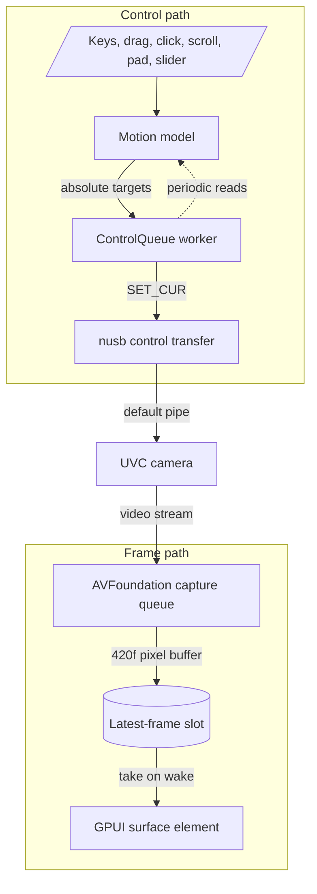

# camctl

camctl is a macOS menu bar app and command line tool for controlling UVC webcams. It was built for the OBSBOT Tiny 2 Lite and uses only the standard UVC 1.1 camera terminal and processing unit controls, so it applies to any UVC camera that advertises them.

To keep CPU and GPU use low, the app streams only while its preview can be seen, prefers stream formats that need no decoding, caps the preview at 30 fps, and hands frames to the GPU without copying them.

The workspace produces two programs:

- `camctl.app` (crate `camctl-app`): a menu bar icon and a floating live preview with pan, tilt and zoom.
- `camctl` (crate `camctl-cli`): a CLI that lists cameras and reads and writes their controls.

## Scope

camctl does not:

- Drive OBSBOT's AI features or any vendor controls. Vendor extension units are parsed from the descriptors and never driven, so tracking, gestures and similar settings stay in the vendor's app.
- Provide a virtual camera. Other apps read the camera directly, and camctl changes the controls they see.
- Run on anything but macOS. Capture uses AVFoundation, the menu bar and window code use AppKit, and USB device matching relies on IOKit location IDs.

## Features

### Menu bar icon

- The icon is a gimbal camera drawn in code as a template image, so it follows the menu bar's light or dark appearance. The lens fills while frames are streaming.
- Left click shows or hides the preview. Right click or Control-click opens a menu with **Show or Hide Preview** and **Quit camctl**.
- The app has no Dock icon.

### Preview window

- The window floats above other apps' windows, appears on every Space and alongside full-screen apps. It opens at 640x420 points and resizes down to 320x220.
- Closing the window hides it. The menu bar icon brings it back; quit from the menu bar menu.
- Video is zero-copy. AVFoundation delivers IOSurface-backed 420f `CVPixelBuffer`s, and GPUI's `surface` element draws them without copying. Only the newest frame is kept, and late frames are discarded.
- The camera streams only while the window can be seen and the user is present. Hiding the window, covering it, a sleeping display, the screen saver and the lock screen each stop the capture session, and the camera light goes off. The screen saver and lock screen are watched through system notifications, because macOS does not count the screen saver as covering other windows.
- A dot in the title bar turns green while frames arrive, next to the camera's name.

### Pan, tilt and zoom

Every input becomes either a held motion, which advances the camera smoothly while held, or a one-shot target.

| Input | Action |
|-------|--------|
| Arrow keys, held | Pan at up to 45 degrees per second and tilt at up to 35 degrees per second, reaching full speed over 0.25 s |
| Shift with a movement key | Move at 30 percent of full speed, for fine framing |
| `+` or `=`, and `-`, held | Zoom in or out at up to 60 zoom units per second |
| Drag on the video | Joystick: direction and speed follow the offset from where the drag began. Speed grows with the square of the distance, from a 4 px dead zone to full speed at 140 px |
| Click on the video | Aim the camera so the clicked point comes to the centre. A ring marks the point for 0.6 s |
| Scroll on the video | Zoom by 4 units per scroll line, or 0.15 units per pixel on a trackpad |
| On-video pad | Appears while the pointer is over the video. The arrow and zoom buttons move while pressed and held |
| `H`, `0`, or the pad's centre button | Home: pan and tilt to 0, zoom all the way out |

Zoom units are the camera's own (0 to 100 on the Tiny 2 Lite). When several inputs are held, a drag takes precedence over a pad button, and a pad button over the keyboard. Held input is released when the window loses focus, so a missed key-up cannot leave the camera moving.

The bar below the video holds the zoom slider, the current magnification (1.0x to 4.0x), and the pan and tilt angles in degrees. Pan is shown with positive to the right.

Drag and click aiming require a camera that reports absolute pan and tilt with a readable range. Zoom inputs and the slider require absolute zoom. The pad shows only the buttons the camera supports.

## Prerequisites

- macOS 14 or later.
- Rust stable, 1.90 or later (the workspace `rust-version`, edition 2024).
- Xcode Command Line Tools, for the linker: `xcode-select --install`.
- For the app: an Apple Development code signing identity in the login keychain. List identities with `security find-identity -v -p codesigning`; Xcode can create one under Settings, Accounts, Manage Certificates.
- A UVC camera. Pan and tilt need absolute pan-tilt support, and zoom needs absolute zoom support.

## Building

```sh
git clone https://github.com/jamesainslie/camctl
cd camctl
```

### CLI

```sh
cargo build -j 3 --release -p camctl-cli
./target/release/camctl list
```

To install `camctl` into `~/.cargo/bin`:

```sh
cargo install --path crates/cli
```

The CLI sends USB control requests only and opens no video stream, so it runs as a plain binary.

### App bundle

```sh
scripts/bundle.sh
open dist/camctl.app
```

`scripts/bundle.sh [release|debug]` builds `camctl-app` with the given profile (default `release`), assembles `dist/camctl.app`, writes its `Info.plist`, signs the bundle and verifies the signature. The bundle identifier is `us.ainslies.camctl`, and its version comes from the workspace `Cargo.toml`.

| Variable | Default | Description |
|----------|---------|-------------|
| `CAMCTL_JOBS` | `3` | `cargo build -j` parallelism |
| `CAMCTL_SIGN_IDENTITY` | `Apple Development` | `codesign` identity |

If the keychain holds more than one Apple Development certificate, `codesign` rejects the default as ambiguous. Set `CAMCTL_SIGN_IDENTITY` to the certificate's full name or SHA-1 hash from `security find-identity`.

The app must run as a bundle because macOS grants camera access per signed app bundle, and the request must come from an app whose `Info.plist` carries `NSCameraUsageDescription`, the text shown in the permission prompt. The bundle also sets `LSUIElement`, which keeps the app out of the Dock. macOS remembers the grant by the app's code signature. A stable identity such as an Apple Development certificate keeps the grant across rebuilds; an ad hoc signature changes with every build, so macOS would ask again each time.

On first launch macOS asks for camera access. If access is denied, the preview says so and points to System Settings, Privacy & Security, Camera. To clear the decision and be asked again:

```sh
tccutil reset Camera us.ainslies.camctl
```

Set `CAMCTL_TRACE=1` to log startup steps and the chosen stream format to stderr:

```sh
open --env CAMCTL_TRACE=1 --stderr /tmp/camctl.log dist/camctl.app
tail -f /tmp/camctl.log
```

## CLI usage

```text
camctl [-c N] <command>
```

`-c`, `--camera` selects a camera by its index from `camctl list` (default `0`). The flag is global, so it may appear before or after the command.

| Command | Description |
|---------|-------------|
| `camctl list` | Connected UVC cameras, ordered by USB location: index, product name, `VID:PID` and IOKit location ID |
| `camctl controls` | Every control the camera advertises, with its current value and its range, step and default where the camera reports them |
| `camctl formats` | Streaming formats, frame sizes and frame rates from the USB descriptors |
| `camctl get <control>` | Read one control |
| `camctl set <control> <value>` | Write one control, then print the value read back |
| `camctl point <right> <up>` | Point the camera, in degrees right and up from centre, on every camera |
| `camctl home` | Pan and tilt to 0, and zoom all the way out |

### Examples

```sh
camctl list                          # find the camera index
camctl -c 1 controls                 # controls of the second camera
camctl formats
camctl point -20 5                   # 20 degrees left, 5 degrees up
camctl get pan-tilt                  # the camera's own values (an OBSBOT shows pan 20.0°)
camctl set pan-tilt -20,5            # the same move through set
camctl set zoom 40
camctl set brightness -5
camctl set focus-auto on
camctl set anti-flicker 60
camctl set exposure-mode manual
camctl set pan-tilt-move 1,5,-1,3    # starts a relative move
camctl set pan-tilt-move 0,0,0,0     # stops it
camctl home
```

Negative values parse as values, not flags, so `camctl point -20 5` and `camctl set brightness -5` need no `--`. `set` prints the value read back as `key = value`. Relative controls often cannot be read, in which case `set` reports that the write succeeded and the read-back was unavailable. Relative moves (`*-move`) continue until a stop is sent.

### Control keys and values

| Keys | Value syntax | Example |
|------|--------------|---------|
| `zoom`, `focus`, `exposure`, `exposure-step`, `exposure-priority`, `iris`, `iris-step`, `roll`, `scanning-mode`, `backlight`, `brightness`, `contrast`, `gain`, `hue`, `saturation`, `sharpness`, `gamma`, `white-balance`, `digital-zoom`, `digital-zoom-limit` | An integer that fits the control's wire width | `camctl set zoom 40` |
| `focus-auto`, `white-balance-auto`, `white-balance-component-auto`, `hue-auto`, `privacy` | `on` or `off` (also `true`/`false`, `1`/`0`) | `camctl set focus-auto off` |
| `anti-flicker` | `off`, `50`, `60` or `auto` | `camctl set anti-flicker 50` |
| `exposure-mode` | `manual`, `auto`, `shutter` or `aperture`, or one single-bit integer | `camctl set exposure-mode auto` |
| `pan-tilt` | `PAN,TILT` in degrees | `camctl set pan-tilt 10,-5` |
| `pan-tilt-move` | `PAN_DIR,PAN_SPEED,TILT_DIR,TILT_SPEED`, directions `-1`, `0` or `1` | `camctl set pan-tilt-move 0,0,1,3` |
| `zoom-move`, `focus-move`, `roll-move` | `DIR,SPEED`, direction `-1`, `0` or `1` | `camctl set zoom-move -1,2` |
| `white-balance-component` | `BLUE,RED`, each 0 to 65535 | `camctl set white-balance-component 2000,2400` |

`camctl controls` lists only the keys the selected camera advertises. Values are checked against the control's type and width before anything is sent.

## Architecture

| Crate | Responsibility |
|-------|----------------|
| `crates/uvc` (`camctl-uvc`) | UVC descriptor parsing, the control catalogue, wire encoding of values, and `Camera`, which drives controls through a `Transport` trait. No I/O |
| `crates/usb` (`camctl-usb`) | `Transport` over nusb (IOKit): finds devices with a UVC video control interface and sends class requests on the default control pipe, 500 ms timeout |
| `crates/capture` (`camctl-capture`) | AVFoundation devices, camera permission, the stream format policy, and a capture session that keeps only the newest frame |
| `crates/core` (`camctl-core`) | UI-independent logic: the motion model and `ControlQueue` |
| `crates/cli` (`camctl-cli`) | The `camctl` binary |
| `crates/app` (`camctl-app`) | The GPUI app (through gpui-kit): preview window, AppKit menu bar item, screen saver and lock watcher |



**Frame path.** The capture session's video output asks AVFoundation for 420f, Metal-compatible pixel buffers and discards late frames. Its delegate runs on a serial dispatch queue and replaces the contents of a one-frame slot. It wakes the UI thread only when it fills an empty slot, so at most one wake-up is outstanding however fast frames arrive. The UI thread takes the frame and passes its pixel buffer to GPUI's `surface` element, drawn with object-fit cover. Buffers in any other pixel format are dropped, because GPUI's surface renderer accepts only 420f.

**Control path.** While input is held, the app ticks the motion model every 33 ms. Each tick ramps the velocity toward the held speed and advances absolute pan, tilt and zoom targets. Releasing stops the targets at once, and the motor's own lag brings the camera to rest. Clicks, scroll steps, the slider and Home produce single targets. Targets go to `ControlQueue`, which keeps only the newest value per control. A worker thread sends whatever is pending, so a burst of requests collapses to the write in flight plus the final value. Reads queue the same way and run after the pending writes. Control transfers use the default pipe and need no exclusive access, so they work while the system driver owns the camera and other apps stream from it.

**Pairing.** The app previews the first USB camera AVFoundation lists, or the first camera of any kind. For a UVC camera, AVFoundation's unique ID encodes the IOKit location ID, vendor ID and product ID, and the app opens the nusb device that matches all three. Enumeration and the first reads run off the UI thread, and each first read is tried up to 4 times, 150 ms apart, because a camera that is starting its stream can stall or time out briefly.

## Development

```sh
cargo test -j 3 --workspace
cargo clippy -j 3 --workspace --all-targets
cargo run -j 3 -p camctl-capture --example devices
```

The tests need no camera. The `uvc` tests parse configuration descriptors captured from an OBSBOT Tiny 2 Lite (`crates/uvc/tests/fixtures`) and drive `Camera` through fake transports. The `core` tests cover the motion model, the click and drag geometry, and the queue's coalescing. The workspace lints enable Clippy's `all` and `pedantic` groups as warnings and deny `unsafe_op_in_unsafe_fn`.

The `devices` example prints the camera permission state and each AVFoundation device with its formats as the format policy classifies them.

## Notes and limitations

- **AVFoundation format names.** On macOS, a UVC camera's MJPEG modes appear in AVFoundation already decoded, with the media subtype `420v`, and its raw modes keep their own subtype, `yuvs` for YUY2. camctl therefore counts `420v` from a USB camera as MJPEG, with a decoding cost, and `420v` from the built-in camera as native.
- **Format policy.** An uncompressed mode such as YUY2 is preferred whenever it covers the preview width within a 1.5x stretch, since it needs no decoding. Otherwise the smallest MJPEG mode that covers it within 1.1x is used. Modes below 24 fps or wider than 1920 px are skipped, and the frame rate is capped at 30 fps. The app chooses the format once, when the camera opens, for a 960x540 device-pixel preview; on the Tiny 2 Lite that selects 640x360 YUY2. Resizing the window does not change the format.
- **Other apps.** While another app is using the camera, camctl leaves the active format alone, since changing it would change that app's stream too.
- **OBSBOT pan direction.** OBSBOT cameras pan left for positive pan, against the UVC convention. `camctl-core`'s quirks table recognises them by USB vendor ID `0x3564`, and both the app and `camctl point` work in right-and-up terms on every camera. `camctl get` and `camctl set pan-tilt` show and take the camera's own values, so on an OBSBOT their pan sign is the opposite of the app's readout.
- **Relative pan.** The Tiny 2 Lite's relative pan-tilt control pans in one direction only. This is why the app never uses relative moves and instead streams absolute targets that advance at a steady rate. The CLI's `pan-tilt-move` is subject to the same camera behaviour.
- **Position sync.** The camera's on-device tracking can move it without camctl. While the preview streams and no input is held, the app reads pan, tilt and zoom every 2 s and adopts them, so held moves and click-to-aim start from where the camera points.
- **Click to focus.** UVC 1.1 has no focus-point control. A click aims the camera at the point, and the camera's continuous autofocus then focuses on what is now centred. This requires autofocus to be on, for example with `camctl set focus-auto on`.
- **Lens geometry.** Click-to-aim needs the lens's field of view. The quirks table knows the Tiny 2 Lite (67.2 degrees horizontal, 1x to 4x zoom). Other cameras get a typical webcam guess (70 degrees, no assumed zoom magnification), so a click lands close and a second click refines it. The aim rotates the clicked ray by the current tilt, so corners and tilted views aim correctly.
- **Camera choice.** The app has no camera picker. A built-in camera, used only when no USB camera is present, gets a preview without controls. The CLI selects cameras with `-c`.
- **USB access.** nusb opens a device exclusively when it can and falls back to shared access when the system driver has claimed it, which is the usual case for a camera. Quit camctl before running a vendor firmware updater that needs the device to itself.
- **UVC coverage.** camctl reads the first video function of a device, addresses the first processing unit, and omits the analog video controls and the UVC 1.5 additions.

## License

The workspace `Cargo.toml` declares the MIT license.
