# Releasing camctl

Releases are changelog-driven. `CHANGELOG.md` (Keep a Changelog) says what a
release contains, and that decides its version. Version numbers are never
typed by hand: `cargo xtask release` derives them, writes them into the
single workspace version in `Cargo.toml`, and moves the changelog entries
under the new version.

## Versioning rules

The next version comes from the categories under `## [Unreleased]`:

| Version line | `Removed`, or a `BREAKING` note | `Added`, `Changed`, `Deprecated` | `Fixed`, `Security` |
|---|---|---|---|
| 0.x | minor (0.1.3 to 0.2.0) | patch | patch |
| 1.0 and later | major | minor | patch |

While the version is 0.x a minor bump is the breaking boundary, as it is
for Cargo. The first release takes the version already in `Cargo.toml`.
`cargo xtask release --version X.Y.Z` overrides the derived version, for
example to go to 1.0.0.

## Day to day

Every pull request adds a line under `## [Unreleased]` in the right
category. CI fails a PR that does not touch `CHANGELOG.md`. Label a PR
`skip-changelog` when it changes nothing a user could notice, such as CI
tweaks or refactors. Dependabot's action updates carry that label already.

## Cutting a release

```mermaid
flowchart LR
    branch[Release branch] --> prep[cargo xtask release]
    prep --> pr[PR: chore release vX.Y.Z]
    pr --> merge[Squash-merge to main]
    merge --> tag[cargo xtask tag on main]
    tag --> push[git push origin vX.Y.Z]
    push --> workflow[release workflow]
    workflow --> published[GitHub release with app, CLI, checksums]
    published --> tap[yaklabco/homebrew-tap cask and formula]
```



1. From an up-to-date `main`, create a branch, for example `release-v0-2-0`.
2. Preview the release with `cargo xtask release --dry-run`, then run
   `cargo xtask release`. It checks that the tree is clean and the tag is
   new, then:
   - cuts `## [Unreleased]` into `## [X.Y.Z] - date`,
   - updates the compare links,
   - sets the workspace version,
   - updates `Cargo.lock`,
   - and commits `chore(release): vX.Y.Z`.
3. Push the branch, open a PR, and let CI pass. Merge it.
4. On `main`, pull, then run `cargo xtask tag` (an annotated `vX.Y.Z` tag
   on HEAD) and push the tag: `git push origin vX.Y.Z`.
5. The `release` workflow builds from the tagged sources alone. It
   restores no Cargo build cache and no mise tool cache, so a cache
   poisoned by another run cannot reach a release. It:
   - installs the pinned toolchain and the tools pinned in `mise.toml`,
   - checks that the tag matches `Cargo.toml` and the changelog,
   - runs `cargo xtask ci`, the checks described in the README's
     [Checks](../README.md#checks) section,
   - builds `camctl-X.Y.Z-macos-arm64.zip` (the app),
     `camctl-cli-X.Y.Z-macos-arm64.tar.gz` and `SHA256SUMS`,
   - publishes a GitHub release, with that version's changelog section
     as the notes,
   - and, when the `HOMEBREW_TAP_TOKEN` secret exists, writes
     `Casks/camctl.rb` and `Formula/camctl-cli.rb` with
     `cargo xtask homebrew` and pushes them to the `main` branch of
     [yaklabco/homebrew-tap](https://github.com/yaklabco/homebrew-tap).

## Homebrew

`HOMEBREW_TAP_TOKEN` is a token that can push to yaklabco/homebrew-tap,
the same secret the yaklabco repositories use for GoReleaser. Without it
the release skips the tap. To update the tap by hand for a published
release:

```sh
gh release download vX.Y.Z --pattern SHA256SUMS --dir /tmp/camctl-sums
cargo xtask homebrew --tap path/to/homebrew-tap --sums /tmp/camctl-sums/SHA256SUMS
```

Run it from the release's commit, since the version comes from
`Cargo.toml`. Then commit `chore(brew): update camctl to vX.Y.Z` in the
tap and push.

The cask and formula download through the tap's
`GitHubPrivateRepositoryReleaseDownloadStrategy`, because this repository
is private. Installing needs `HOMEBREW_GITHUB_API_TOKEN` set to a token
that can read it.

## Signing and notarization

Every release is Developer ID signed, with the hardened runtime and the
camera entitlement, and notarized with the ticket stapled. The release
workflow fails at its first step when any secret below is missing, and
`scripts/verify-signed.sh` must pass before anything is published. An
ad-hoc build would be blocked by Gatekeeper when downloaded, and macOS
would ask for camera access again after every update, because an ad-hoc
signature changes with every build.

The repository secrets:

| Secret | Value |
|---|---|
| `APPLE_DEVELOPER_ID_P12` | The Developer ID Application certificate and key, exported from Keychain Access as .p12, then `base64 -i cert.p12` |
| `APPLE_DEVELOPER_ID_PASSWORD` | The .p12 export password |
| `APPLE_DEVELOPER_ID_IDENTITY` | The identity name, for example `Developer ID Application: Name (TEAMID)` |
| `APPLE_ID` | The Apple ID used for notarization |
| `APPLE_TEAM_ID` | The team ID |
| `APPLE_APP_PASSWORD` | An app-specific password for that Apple ID |

`scripts/bundle.sh` signs with the hardened runtime and the camera
entitlement in `scripts/camctl.entitlements` whenever the identity is a
Developer ID one, and `cargo xtask dist` notarizes and staples the app
before zipping it.

### A signed release built locally

To build and check a release on your own Mac, with the Developer ID
certificate in the login keychain, save the notary credentials in the
keychain once:

```sh
xcrun notarytool store-credentials camctl-notary \
  --apple-id you@example.com --team-id TEAMID
```

It asks for the app-specific password. Then:

```sh
CAMCTL_SIGN_IDENTITY="Developer ID Application: Name (TEAMID)" \
CAMCTL_NOTARY_PROFILE=camctl-notary \
  cargo xtask dist
scripts/verify-signed.sh dist/camctl.app
```

`CAMCTL_NOTARY_PROFILE` takes precedence over `APPLE_ID`, so no password
is ever in the environment. Day-to-day builds keep using the Apple
Development identity, which `scripts/bundle.sh` picks by default.
